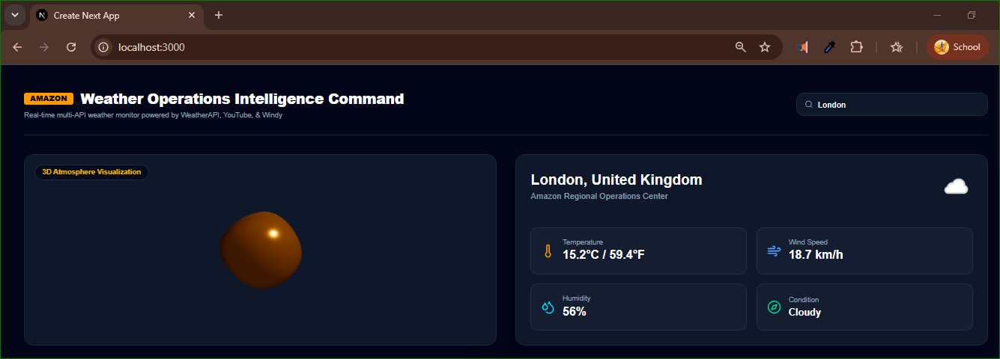
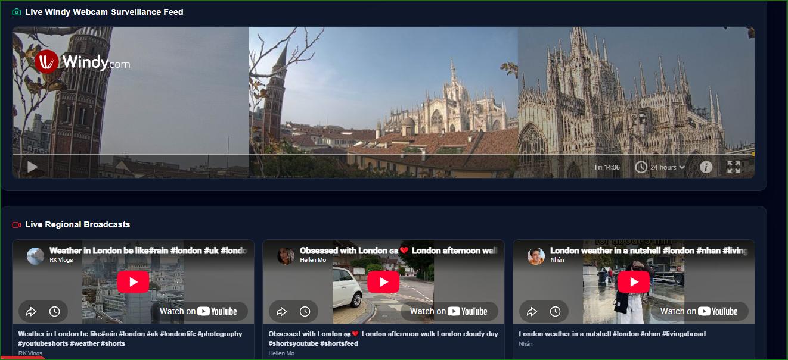

# Weather Operations Intelligence Command

A real-time weather monitoring dashboard built with **Next.js**, integrating weather API data, YouTube regional broadcasts, and Windy live webcam feeds into a unified weather intelligence interface.

## UI Screenshots

### 1. Main Dashboard

The main dashboard displays the 3D atmosphere visualization alongside real-time weather information, including temperature, wind speed, humidity, and current weather conditions.



### 2. API Data and Regional Weather Monitoring

This interface integrates live Windy webcam surveillance feeds and regional YouTube broadcasts to provide additional visual context for weather monitoring.



## Features

- **Real-Time Weather Monitoring:** Retrieve and display weather information using a weather API.
- **3D Atmosphere Visualization:** Interactive visual representation of the atmosphere.
- **Weather Metrics:** Monitor temperature, wind speed, humidity, and weather conditions.
- **Live Windy Webcam Feed:** View available live webcam feeds for weather observation.
- **Regional YouTube Broadcasts:** Display relevant regional weather videos and broadcasts.
- **Location-Based Search:** Search for weather information by city.
- **Responsive Dashboard:** A modern dark-themed interface for weather intelligence and monitoring.

## Tech Stack

- **Frontend:** Next.js, React, TypeScript
- **Styling:** CSS
- **Data Integration:** Weather API, YouTube, Windy
- **Development Environment:** Node.js, npm

## Getting Started

### Prerequisites

Make sure you have the following installed:

- [Node.js](https://nodejs.org/)
- npm (included with Node.js)

### Installation

1. Clone the repository:

   ```bash
   git clone https://github.com/abusufianrobin/amazon-weather-dashboard
   ```

2. Navigate to the project directory:

   ```bash
   cd amazon-weather-dashboard
   ```

3. Install the dependencies:

   ```bash
   npm install
   ```

4. Start the development server:

   ```bash
   npm run dev
   ```

5. Open [http://localhost:3000](http://localhost:3000) in your browser.

## Project Structure

```text
amazon-weather-dashboard/
├── .env.local
├── app/
│   ├── api/
│   │   └── dashboard/
│   │       └── route.ts
│   ├── globals.css
│   ├── layout.tsx
│   └── page.tsx
├── components/
│   ├── Weather3DCanvas.tsx
│   ├── WeatherMetrics.tsx
│   ├── WebcamPlayer.tsx
│   └── YoutubeVideos.tsx
├── lib/
│   └── api.ts
├── UI_Output/
│   └── API_Data.PNG
|   └── Dashboard.PNG
├── package.json
└── tailwind.config.ts
```

*Note: Adjust the project structure above to match your actual repository.*

## Learn More

- [Next.js Documentation](https://nextjs.org/docs)
- [React Documentation](https://react.dev/)
- [WeatherAPI Documentation](https://www.weatherapi.com/docs/)
- [YouTube Data API Documentation](https://developers.google.com/youtube/v3)
- [Windy Documentation](https://api.windy.com/)

## Deployment

You can deploy this Next.js application using [Vercel](https://vercel.com/).

For more information, see the [Next.js deployment documentation](https://nextjs.org/docs/app/building-your-application/deploying).

## Author

**Abu Sufian Robin**

- GitHub: [abusufianrobin](https://github.com/abusufianrobin)
- Portfolio: [abusufianrobin.github.io](https://abusufianrobin.github.io)
